# TaskPad PHP

**CIS 525 – Web Technology | Project 3**

**Student:** Giovanna Ponce Cisternas  
**University:** University of Michigan-Dearborn  
**Semester:** Fall 2026

## 1. Project Overview

TaskPad PHP is a simple task management web application developed using PHP, HTML, and CSS.

The application allows users to create, view, search, filter, complete, and delete tasks. All task information is stored in a JSON file, so no database is required.

The project focuses on server-side form handling, input validation, file-based data storage, and responsive web design.

## 2. Features

### Task Creation
- Create a task with a required title.
- Add an optional description.
- Select Low, Medium, or High priority.
- Set an optional due date.
- Validate user input on the server.
- Display error messages and preserve entered values when validation fails.

### Task List and Filters
- Display tasks in a structured table.
- Show each task's title, description, priority, status, and due date.
- Search tasks by title or description.
- Filter tasks by priority.
- Filter tasks by status using All, Open, and Completed.
- Display task counts for Total, Open, and Completed.
- Display messages when the task list is empty or no tasks match the filters.

### Task Management
- Mark an open task as completed.
- Delete an existing task.
- Display confirmation messages after successful actions.
- Save task changes in a JSON file.

### Responsive Design
The interface includes a sidebar, task summary, filters, and task table. The layout adjusts to different screen sizes, including desktop, tablet, and mobile devices.

## 3. Technologies Used

- PHP 7.4 or later
- HTML5
- CSS3
- JSON
- XAMPP for local development
- Visual Studio Code

The project does not use a PHP framework or a database.

## 4. Project Structure

```text
taskpad-php/
│
├── public/
│   ├── index.php
│   ├── create.php
│   ├── actions.php
│   └── assets/
│       └── style.css
│
├── src/
│   ├── storage.php
│   ├── validation.php
│   └── helpers.php
│
├── data/
│   └── tasks.json
│
├── docs/
│   ├── uml-usecase.pdf
│   ├── uml-class.pdf
│   └── screenshots/
│       ├── 01-task-list-desktop.png
│       ├── 02-filter-open.png
│       ├── 03-filter-completed.png
│       ├── 04-search-priority.png
│       ├── 05-create-task.png
│       ├── 06-validation-errors.png
│       ├── 07-create-success.png
│       ├── 08-complete-task.png
│       ├── 09-delete-task.png
│       ├── 10-tablet.png
│       └── 11-mobile.png
│
└── README.md
```

## 5. How to Run the Project

### Requirements

- PHP 7.4 or later
- A web browser
- A terminal or command-line interface

### Instructions

1. Download or clone the repository.
2. Open the project folder in Visual Studio Code.
3. Open a terminal in the `taskpad-php` directory.
4. Start the PHP development server:

```bash
php -S localhost:8000 -t public
```

5. Open the following address in a browser:

http://localhost:8000

### Running with XAMPP on Windows

If PHP is installed through XAMPP and is not available in the system PATH, use this command in PowerShell:

```powershell
& "C:\xampp\php\php.exe" -S localhost:8000 -t public
```

The command should be executed from the `taskpad-php` directory.

**Note:** The `data/tasks.json` file must exist and be writable. It can be initialized with an empty JSON array:

```json
[]
```

## 6. How to Use the Application

1. Open TaskPad PHP in a web browser.
2. Click **Add New Task** or **Add Task** in the sidebar.
3. Enter a task title and any optional details.
4. Click **Add Task** to save the task.
5. Return to **My Tasks** to view the list.
6. Use the search field or priority dropdown to filter tasks.
7. Use **All**, **Open**, or **Completed** to filter tasks by status.
8. Click **Complete** to mark an open task as finished.
9. Click the trash icon to delete a task.

Completed tasks are displayed with a green status badge and a crossed-out title.

## 7. Data Storage

TaskPad PHP uses JSON file storage instead of a database.

Tasks are saved in:

`data/tasks.json`

Each task contains the following fields:

| Field | Description |
|---|---|
| id | Unique task identifier |
| title | Required task title |
| description | Optional description |
| priority | Low, Medium, or High |
| due | Optional due date |
| completed | Boolean task status |

The `data` folder is located outside the `public` directory to prevent direct access to the JSON file through the local web server.

## 8. Validation and Security

The application includes basic server-side validation and security measures:

- Required title validation.
- Maximum length validation for title and description.
- Validation of allowed priority values.
- Due date validation.
- HTML output escaping.
- CSRF token verification for form submissions.
- POST requests for creating, completing, and deleting tasks.
- Redirects after successful form submissions.

These measures help protect user input and ensure that submitted task information is valid.

## 9. UML Diagrams

Two UML diagrams were created for the project.

### Use Case Diagram

The Use Case Diagram illustrates the main actions available to a user:

- Create Task
- List Tasks
- Filter Tasks
- Complete Task
- Delete Task

[View Use Case Diagram (PDF)](docs/uml-usecase.pdf)

### Class Diagram

The Class Diagram presents a conceptual model with three classes:

- Task
- TaskRepository
- Validator

It illustrates the task attributes, storage responsibilities, and validation operations.

[View Class Diagram (PDF)](docs/uml-class.pdf)

**Note:** The PHP implementation uses functions and associative arrays. The Class Diagram represents the conceptual design rather than PHP classes implemented directly in the source code.

## 10. Testing and Screenshots

The application was tested locally using PHP and a web browser.

Testing included task creation, input validation, task listing, text and priority filtering, status filtering, task completion, deletion, and JSON persistence.

The following screenshots document the application and its main features.

### 10.1 Task List – Desktop

The main dashboard displays task counts, filters, and the task list.

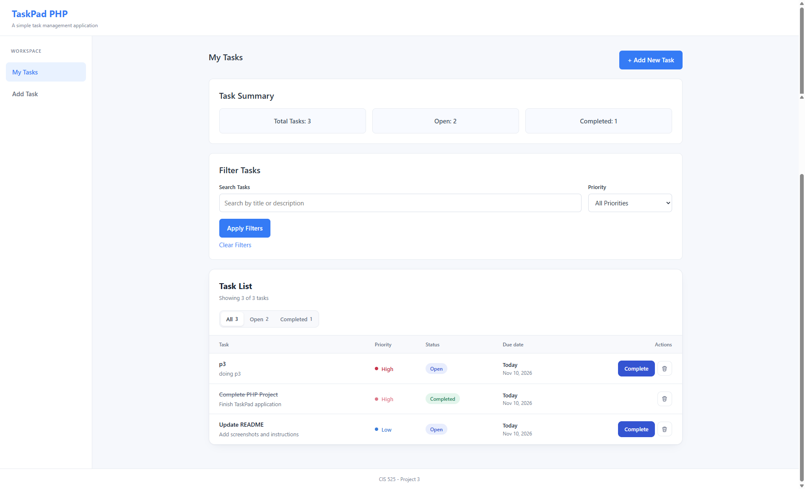

### 10.2 Open Tasks Filter

The Open tab displays only tasks that have not been completed.

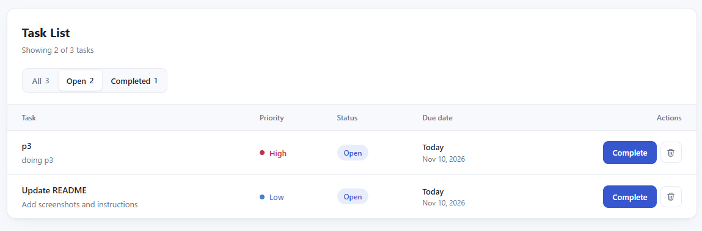

### 10.3 Completed Tasks Filter

The Completed tab displays only completed tasks.

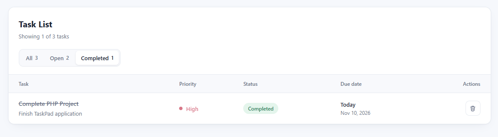

### 10.4 Priority Filter

The priority dropdown allows users to display tasks with a selected priority.

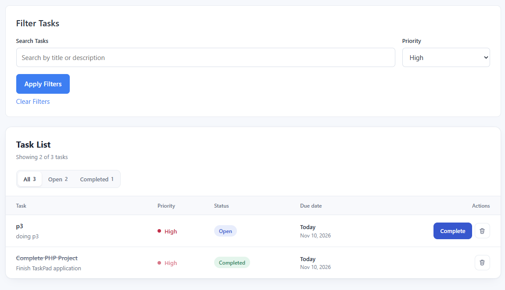

### 10.5 Create Task Form

The task creation form includes the title, description, priority, and optional due date.

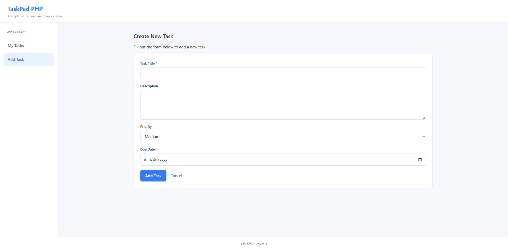

### 10.6 Input Validation

Submitting the form without a title displays a server-side validation error.

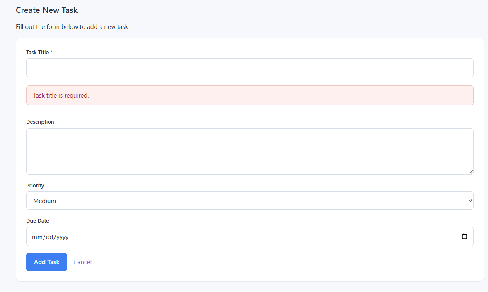

### 10.7 Successful Task Creation

After creating a task, the application redirects to the task list and displays a success message.

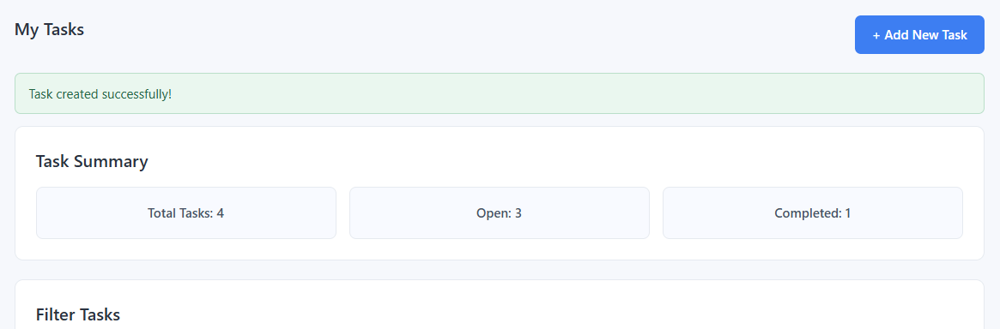

### 10.8 Complete Task

The Complete button updates the task status and displays a confirmation message.

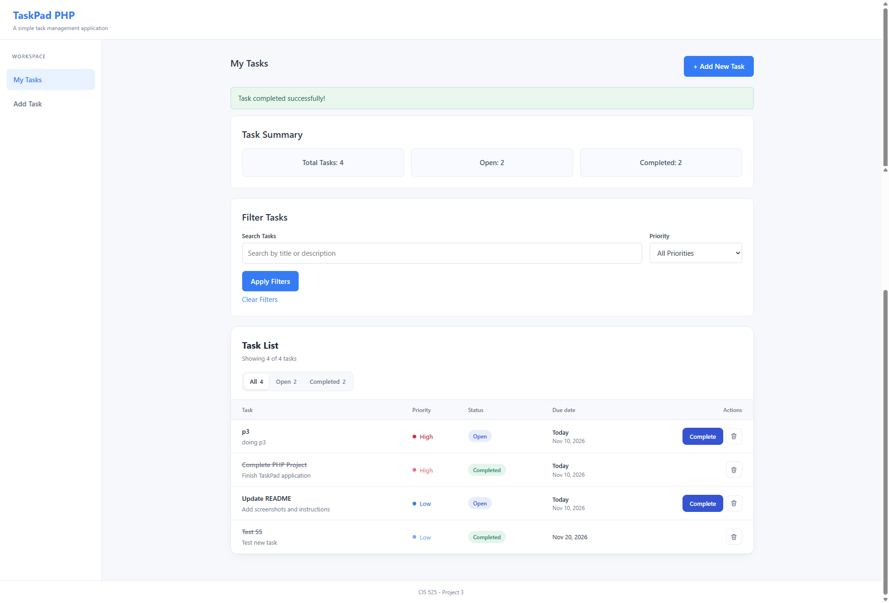

### 10.9 Delete Task

Deleting a task removes it from the JSON file and updates the task counts.

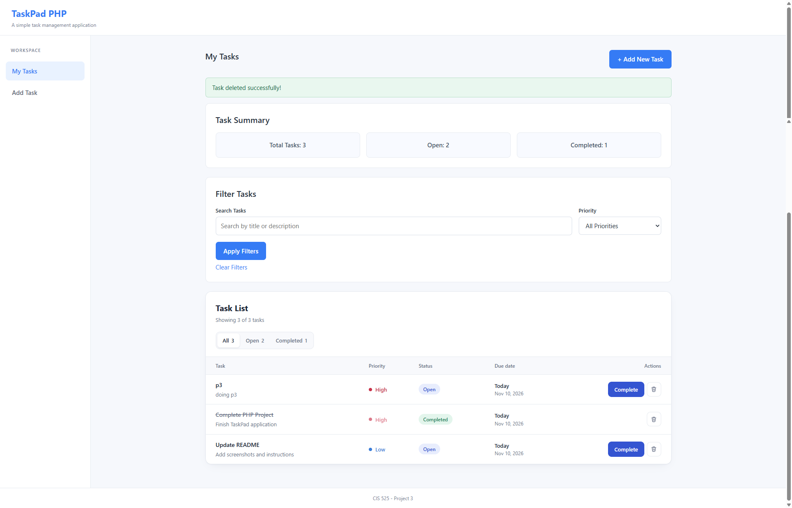

### 10.10 Tablet Layout

The responsive layout was tested using the Surface Pro 10 device preset in browser developer tools.

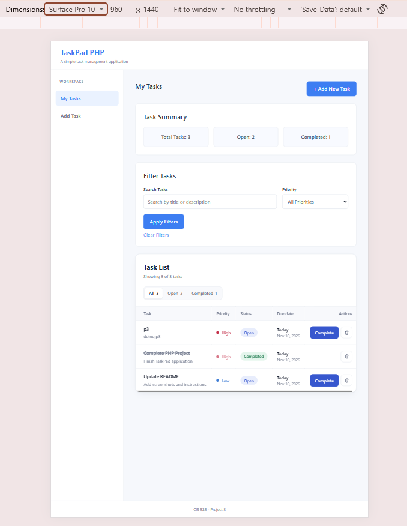

### 10.11 Mobile Layout

The responsive layout was also tested using the iPhone 16 Pro Max device preset in browser developer tools.

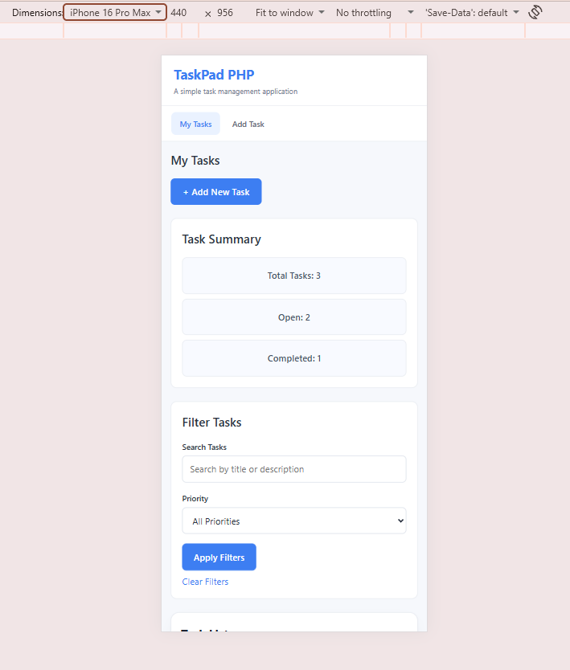

## 11. Project Notes

- TaskPad PHP is an educational project for CIS 525.
- No user account or database is required.
- Tasks are stored locally in a JSON file.
- The application requires a PHP-enabled server.
- GitHub Pages does not support server-side PHP execution.
- The repository contains the source code, UML diagrams, and testing screenshots.

## 12. Author

**Giovanna Ponce Cisternas**  
University of Michigan-Dearborn  
CIS 525 – Web Technology  
Fall 2026
